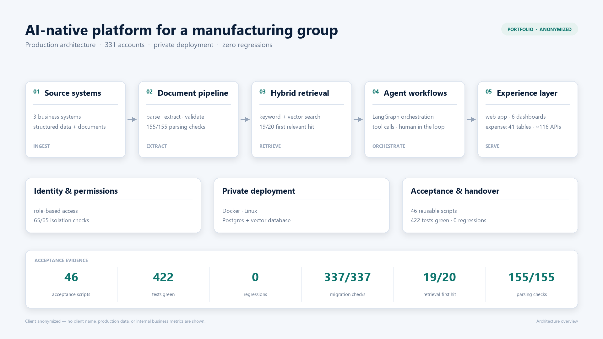
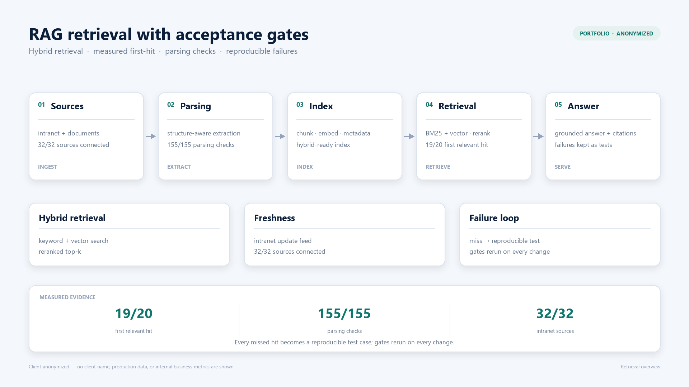

# AI Delivery Case Studies

Anonymized case studies from AI delivery work — RAG systems, LLM agents, evals, and acceptance-gated delivery. Client code and data stay private; this repository documents the problem, the architecture, and the measured acceptance evidence.

## What I do

- Audit a failing AI agent or RAG system and show exactly where it breaks
- Build an eval suite and regression gates so quality stops drifting
- Ship one workflow end-to-end, with runbook and handover
- Cut hallucination, latency, and token cost against agreed thresholds

**How I work:** fixed scope, written acceptance criteria, 20 hours per week, async-friendly across US mornings.

---

## Case 1 — AI-native operating platform for a food-manufacturing group

**Context.** A listed food-manufacturing group needed AI-native internal systems, but had no production foundation and no acceptance discipline: demos existed, measurable delivery did not.

**What I built.** An AI-native operating platform plus an expense-reimbursement system: identity and permissions, hybrid retrieval and document parsing, three business data sources into six management dashboards, and a content/compliance pipeline.

**Acceptance evidence.**
- 46 reusable acceptance scripts; 422 automated tests green, zero regression failures
- 331 accounts migrated; 337/337 migration checks and 65/65 permission-isolation checks passed
- Expense system: 45/45 specification checks, 41 tables, ~116 APIs
- Dashboards built from 1,406 real sales records, 9/9 SQL checks

**Stack:** Python, FastAPI, TypeScript/Node, LangGraph, RAG, Docker, private deployment.

---

## Case 2 — RAG retrieval with acceptance gates

**Context.** Answers could not be trusted: retrieval quality was never measured, and document parsing failed silently on real files.

**What I built.** Hybrid retrieval (keyword + vector), a document-parsing pipeline, and acceptance gates for both — first-hit tests, parsing checklists, and an intranet update feed. Every failure is kept as a reproducible test case.

**Acceptance evidence.**
- First relevant hit: 19/20 queries
- Parsing checks: 155/155
- Intranet update sources: 32/32 connected
- Failure cases retained and re-run on every change

**Stack:** vector database, embeddings, Python, FastAPI.

---

## Case 3 — Multi-agent systems (public repositories)

**OmniPM** — a context-engineering multi-agent orchestration engine. Context is the program; execution is a DAG. Shipped a validation product on top of it: a yoga-studio operations system with a Go backend and a WeChat mini program.

**OmniPM Orion** — a prompt system that turns one agent into a project lead coordinating 13 specialist roles across five project types.

**Verified-progress ledger** — for long-running agent work: an independent verifier certifies each claimed step, and a fingerprint check voids any verdict when the verifier mutates the workspace.

- https://github.com/lion231226/Genesis_OmniPM
- https://github.com/lion231226/omnipm-orion
- https://github.com/lion231226/dsh-verified-progress

**Stack:** JavaScript, TypeScript, Go, prompt engineering, verification loops.

---

## Notes

- Client names, production data, and internal business metrics are removed from these case studies.
- The numbers above are acceptance evidence recorded during delivery, not estimates.
- Client code is private and is not included in this repository.

## Contact

- Upwork: https://www.upwork.com/freelancers/~01b9396da37e8e4efd
- GitHub: https://github.com/lion231226
